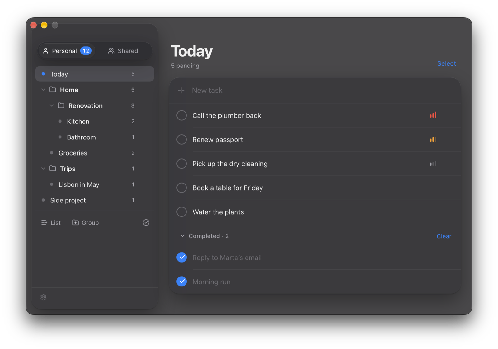
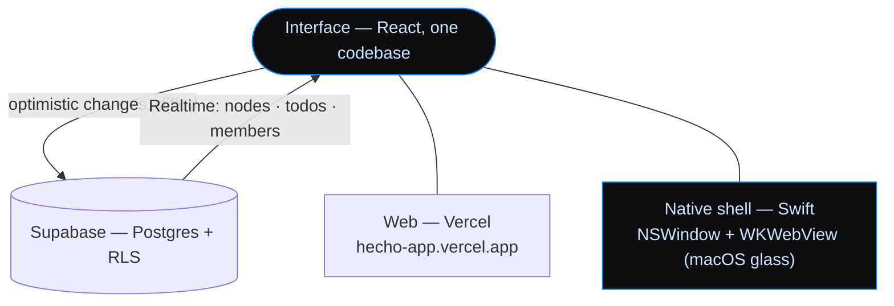

<p align="center">
  
</p>

<p align="center">
  
  
  
  
</p>

Your to-dos, alone or together. Hecho is a quiet task app with two spaces:
a **personal** one that's only yours, and a **shared** one you edit with
someone else in real time. Groups, subgroups, lists and priorities, and
nothing you have to learn.

It's one app in two places: a native window on the Mac, and the same
interface in the browser at **[hecho-app.vercel.app](https://hecho-app.vercel.app)**,
ready to add to your phone's home screen.

<p align="center">
  
</p>

## Index

- [Why](#why)
- [Installation](#installation)
- [Usage](#usage)
- [Sharing a space](#sharing-a-space)
- [Keyboard shortcuts](#keyboard-shortcuts)
- [Your data](#your-data)
- [How it fits together](#how-it-fits-together)
- [Running your own backend](#running-your-own-backend)
- [Known limitations](#known-limitations)
- [License](#license)

## Why

Most to-do apps either stay too simple to organise anything, or grow into
project managers. And the ones you can share usually make you share
everything. Hecho keeps only what you reach for:

- **Two spaces, clearly apart.** Personal stays private. Shared is a whole
  space for two (or more), not a single list you send around.
- **Folders that nest.** Groups hold lists or more groups, as deep as you
  like. Drag things into each other to reorganise.
- **Priority in one click.** Three small bars next to each task; the list
  sorts itself by them.
- **The same everywhere.** The Mac app and the web app are the same
  interface, kept in sync live. The Mac one sits on real macOS glass.

## Installation

**On the web or your phone**, just open
[hecho-app.vercel.app](https://hecho-app.vercel.app) and create an account.
On an iPhone, tap **Share → Add to Home Screen** and it opens full screen,
like an app.

**On the Mac**, Hecho is built from source. You need the Xcode command line
tools (`xcode-select --install`) and Node:

```sh
brew install node
git clone https://github.com/alexcalatyd/Hecho.git
cd Hecho
cp web/.env.example web/.env.local   # then fill in the two Supabase values
./build.sh --install
```

That builds the interface, compiles the app, draws its icon, signs it
ad hoc and installs it into `/Applications`. It needs Apple Silicon and
macOS 14 or later. Built on your own machine, Gatekeeper doesn't get in the
way.

> [!NOTE]
> Without `web/.env.local` the app still works, in **local mode**:
> everything stays in that one device and there's no account or sharing.
> To use the hosted version's accounts, put its Supabase URL and public key
> there; to run your own, see [Running your own backend](#running-your-own-backend).

## Usage

1. Sign in, or create an account (email and password).
2. Write a task in the field at the top and press **Enter**.
3. Click the circle to complete it. Completed tasks fold into their own
   section at the bottom, which you can clear in one go.

On the left, **List** and **Group** create things at the top level; the
**⋯** menu of a group (or a right-click) adds lists and subgroups inside it.
Double-click any name to rename it. Every group shows how many tasks are
pending inside it.

To set a priority, click the bars next to the field (or on any task) until
it's the one you want (new tasks start at low), or start a task with `!`, `!!` or `!!!`:

```
!!! Call the plumber back
```

**Moving things around.** Drag a list or group onto the top or bottom
edge of another to reorder, or onto the middle of a group to put it inside.
Drag a task onto a list in the sidebar to move it there. To work with
several at once, **⌘-click** them (or tap **Select** on the phone) and use
the bar that appears at the bottom to **Move** or **Delete** them.

The gear at the bottom of the sidebar switches the interface between
Spanish and English. It starts in your system's language and remembers your
choice.

## Sharing a space

In the **Shared** space, click the avatars next to the title:

1. **Create invite code.** You get a code like `K7P2-QX9M`.
2. Send it however you like. The other person opens Hecho, goes to their
   Shared space, and types it under **Got an invite?**
3. From then on you both see the same groups, lists and tasks, live. Each
   task shows a small avatar of who added it.

Codes work once and expire after seven days; you can revoke one or make a
new one at any time. If the person joining already had things in their
Shared space, they're merged into yours.

## Keyboard shortcuts

| Shortcut | Action |
|---|---|
| **⌘N** | Jump to the new task field |
| **⌘1** / **⌘2** | Personal / Shared |
| **⌘↑** / **⌘↓** | Raise or lower the priority while typing a task |
| **⌘-click** | Select several lists, groups or tasks |
| **⌘A** | Select every pending task in the list |
| **⌘⌫** | Delete the selection |
| **Esc** | Cancel the selection or the edit |

## Your data

Tasks live in a [Supabase](https://supabase.com) database (Postgres, in
Frankfurt). Row Level Security is on for every table: a space's lists and
tasks can only be read or changed by its members, and that's enforced by the
database itself, not just the app.

Each device also keeps a copy of your spaces so the app opens instantly;
signing out clears it. Collapsed groups and the language are remembered per
device and never leave it.

## How it fits together



- `web/` — the interface: Vite, React and TypeScript, with plain CSS.
  `npm run dev` inside it runs it in a browser; it's also what Vercel
  deploys.
  - `src/lib/store.ts` — the data layer: one hook per space, local cache,
    optimistic writes sent to Supabase as a diff, and the realtime channel.
  - `src/lib/i18n.ts` — Spanish and English, no library.
- `native/main.swift` — the whole Mac app in one file: a fixed-size window,
  the glass behind it, and a web view that serves the built interface.
  Compiled with `swiftc`, no Xcode project.
- `supabase/migrations/` — the schema: spaces, members, the group/list tree,
  tasks, invite codes, row-level policies and the realtime publication.
- `build.sh` — builds `build/Hecho.app`; `--install` copies it to
  `/Applications` and opens it.

<details>
<summary><b>How the Mac app loads the interface</b></summary>
<br>

The built interface is copied into the app bundle and served from a custom
`app://local/` scheme, so ES modules load as they would from a server. The
window has a transparent title bar and an `NSVisualEffectView` behind the
web view; the page paints no background of its own when it detects
`window.webkit.messageHandlers.native`. Dragging the top strip sends a
`drag` message and the native side calls `performDrag`.

</details>

<details>
<summary><b>How syncing works</b></summary>
<br>

Every change is applied locally first. The store then compares the old and
new state and sends only the rows that changed (upserts and deletes, in
order, one batch at a time). Other devices get them through Supabase
Realtime, filtered by space. When the app comes back to the foreground, or
the realtime channel reconnects, it reloads the space in case it missed
something.

</details>

<details>
<summary><b>How invite codes work</b></summary>
<br>

`create_invite(space)` generates eight characters from an alphabet without
look-alikes (no `0/O`, `1/I`) and replaces any previous code for that space.
`join_space(code)` checks it hasn't expired, adds you as a member, merges a
shared space you were alone in, and deletes the code. Both are
`security definer` functions; the tables themselves only allow members in.

</details>

## Running your own backend

1. Create a project on [supabase.com](https://supabase.com) (the free plan
   is enough).
2. In **Authentication → Sign In / Providers → Email**, turn off
   **Confirm email** (or set up your own SMTP first).
3. Apply the schema:

   ```sh
   npx supabase link --project-ref <your-project-ref>
   npx supabase db push --remote
   ```

4. Put the project's URL and publishable (anon) key in `web/.env.local`:

   ```sh
   VITE_SUPABASE_URL=https://<your-project-ref>.supabase.co
   VITE_SUPABASE_ANON_KEY=<publishable key>
   ```

5. Build the Mac app with `./build.sh --install`, or deploy `web/` anywhere
   that serves static files (`npm run build` → `web/dist`).

## Known limitations

- **No password reset yet.** It needs an email provider of its own
  (Supabase's built-in one only reaches the project's team).
- Changes made while offline are kept on screen but lost if you close the
  app before it reconnects.
- Tasks are ordered by priority and date; you can't drag them into a custom
  order yet.
- The Mac app is **Apple Silicon only**, macOS 14 or later, and for now
  built from source.

## License

MIT — see [LICENSE](LICENSE). The npm packages the interface uses keep their
own licenses: see [THIRD_PARTY_NOTICES.md](THIRD_PARTY_NOTICES.md).
